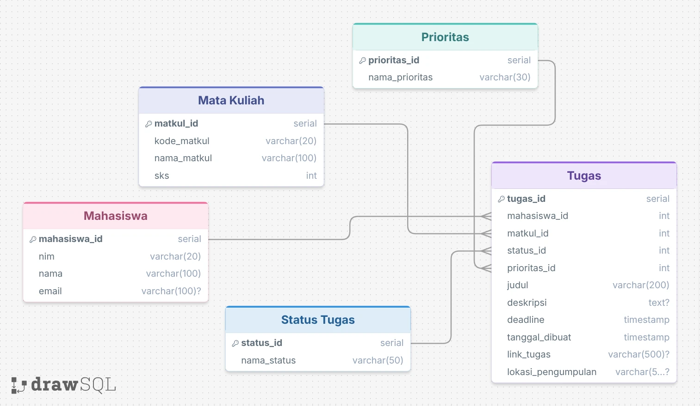

# Manajemen Tugas Mahasiswa

REST API untuk mengelola tugas mahasiswa, mulai dari melihat daftar tugas, menambahkan tugas, memperbarui informasi tugas, hingga menghapus tugas.

## Informasi Proyek

- **Bahasa pemrograman:** Python
- **Framework:** Flask
- **ORM:** Flask-SQLAlchemy
- **Database:** PostgreSQL (Supabase)
- **Deployment:** Vercel
- **Format komunikasi:** JSON

### Link Proyek

- **GitHub Repository:** https://github.com/rifaiakbarnot-ops/manajemen-tugas-mahasiswa
- **Live API:** https://manajemen-tugas-mahasiswa-git-main-rifaiakbarnot-ops.vercel.app/

## Entity Relationship Diagram (ERD)

ERD menggambarkan hubungan antara lima tabel dalam database Manajemen Tugas Mahasiswa.



### Struktur Database

Database terdiri dari lima tabel:

1. **mahasiswa** — menyimpan data mahasiswa.
2. **mata_kuliah** — menyimpan data mata kuliah.
3. **status_tugas** — menyimpan daftar status tugas.
4. **prioritas** — menyimpan tingkat prioritas tugas.
5. **tugas** — menyimpan informasi tugas dan menghubungkannya dengan mahasiswa, mata kuliah, status, dan prioritas.

Tabel `tugas` memiliki primary key `tugas_id` dan foreign key `mahasiswa_id`, `mata_kuliah_id`, `status_id`, serta `prioritas_id`.

## Deployment

API dapat diakses melalui:

**Base URL**

https://manajemen-tugas-mahasiswa-git-main-rifaiakbarnot-ops.vercel.app/

Database menggunakan PostgreSQL pada Supabase. Konfigurasi koneksi database disimpan melalui environment variable `DATABASE_URL` di Vercel.

## Dokumentasi Endpoint API

**Base URL:** `https://manajemen-tugas-mahasiswa.vercel.app`

### 1. Menampilkan Semua Tugas

- Method : GET
- URL : https://manajemen-tugas-mahasiswa.vercel.app/tugas
- Deskripsi : Menampilkan seluruh data tugas mahasiswa
- Headers : Tidak diperlukan
- Request Body : Tidak ada
- Response Sukses (200):
  ```json
  {
    "data": [
      {
        "tugas_id": 1,
        "judul": "Latihan Soal Kalkulus I",
        "deskripsi": "Mengerjakan latihan soal untuk persiapan UTS.",
        "mahasiswa_id": 1,
        "mata_kuliah_id": 1,
        "prioritas_id": 3,
        "status_id": 1,
        "deadline": "2026-10-30T12:00:00",
        "link_tugas": null,
        "lokasi_pengumpulan": "Kertas Folio",
        "tanggal_dibuat": "2026-10-25T13:05:22.747778"
      }
    ]
  }
  ```
  _Catatan: contoh di atas dipersingkat; gunakan seluruh response GET aktual jika ingin mendokumentasikan semua data._

### 2. Menambahkan Tugas Baru

- Method : POST
- URL : https://manajemen-tugas-mahasiswa.vercel.app/tugas
- Deskripsi : Menambahkan tugas baru
- Headers : Content-Type: application/json
- Request Body :
  ```json
  {
    "mahasiswa_id": 1,
    "mata_kuliah_id": 1,
    "prioritas_id": 1,
    "status_id": 1,
    "judul": "Tugas Uji API",
    "deskripsi": "Pengujian endpoint POST",
    "deadline": "2026-11-30 23:59:00",
    "link_tugas": "https://example.com/tugas",
    "lokasi_pengumpulan": "Google Classroom"
  }
  ```
- Response Sukses (201):
  ```json
  {
    "message": "Tugas berhasil ditambahkan",
    "tugas_id": 9
  }
  ```

### 3. Memperbarui Tugas

- Method : PUT
- URL : https://manajemen-tugas-mahasiswa.vercel.app/tugas/ID_TUGAS
- Deskripsi : Memperbarui data tugas berdasarkan ID
- Headers : Content-Type: application/json
- Request Body :
  ```json
  {
    "mahasiswa_id": 1,
    "mata_kuliah_id": 1,
    "prioritas_id": 2,
    "status_id": 2,
    "judul": "Tugas Uji API - Diperbarui",
    "deskripsi": "Pengujian endpoint PUT",
    "deadline": "2026-12-01 23:59:00",
    "link_tugas": "https://example.com/tugas-revisi",
    "lokasi_pengumpulan": "Google Classroom"
  }
  ```
- Response Sukses (200):
  '''json
  {
  "message": "Tugas berhasil diperbarui",
  "tugas_id": 9
  }
  '''

### 4. Menghapus Tugas

- Method : DELETE
- URL : https://manajemen-tugas-mahasiswa.vercel.app/tugas/ID_TUGAS
- Deskripsi : Menghapus tugas berdasarkan ID
- Headers : Tidak diperlukan
- Request Body : Tidak ada
- Response Sukses (200):
  '''json
  {
  "message": "Tugas berhasil dihapus",
  "tugas_id": 9
  }
  '''

## Bukti Pengujian

Pengujian dilakukan menggunakan Thunder Client. Bukti pengujian berupa screenshot request dan response untuk setiap endpoint.

## Cara Menjalankan Secara Lokal

### 1. Clone repository

```bash
git clone https://github.com/rifaiakbarnot-ops/manajemen-tugas-mahasiswa.git
cd manajemen-tugas-mahasiswa
```

### 2. Buat virtual environment

```bash
python -m venv .venv
```

Aktifkan di Git Bash pada Windows:

```bash
source .venv/Scripts/activate
```

### 3. Instal dependensi

```bash
pip install -r requirements.txt
```

### 4. Konfigurasi environment variable

Buat file `.env` di direktori utama proyek:

```env
DATABASE_URL=URL_KONEKSI_POSTGRESQL_KAMU
```

Ganti nilai contoh dengan connection string PostgreSQL milikmu. Jangan mengunggah file `.env` ke GitHub atau membagikan kredensial database.

### 5. Jalankan aplikasi

```bash
python -m flask --app run.py run
```

Aplikasi lokal dapat diakses melalui:

`http://127.0.0.1:5000`

Periksa koneksi database di:

`http://127.0.0.1:5000/db-check`

## Pengujian API

Pengujian dilakukan menggunakan Thunder Client pada URL deployment Vercel.

| Pengujian                          | Hasil                                  |
| ---------------------------------- | -------------------------------------- |
| GET `/tugas`                       | Berhasil menampilkan daftar tugas      |
| GET `/tugas/1`                     | Berhasil menampilkan satu tugas        |
| POST `/tugas`                      | Berhasil menambahkan tugas, status 201 |
| PUT `/tugas/6`                     | Berhasil memperbarui tugas, status 200 |
| DELETE `/tugas/6`                  | Berhasil menghapus tugas, status 200   |
| GET `/tugas/6` setelah penghapusan | Mengembalikan 404 Not Found            |

Screenshot hasil pengujian dilampirkan sebagai bukti pengujian API.

## Keamanan

- Kredensial database disimpan melalui environment variable.
- File `.env` dikecualikan dari Git menggunakan `.gitignore`.
- Request untuk menambahkan dan memperbarui data divalidasi.
- API mengembalikan status HTTP dan pesan error yang sesuai.

## Penutup

Proyek ini dibuat sebagai implementasi REST API menggunakan Flask dan PostgreSQL untuk mengelola tugas mahasiswa. Aplikasi mendukung operasi CRUD, menggunakan relasi antartabel, serta di-deploy agar dapat diakses melalui internet.
